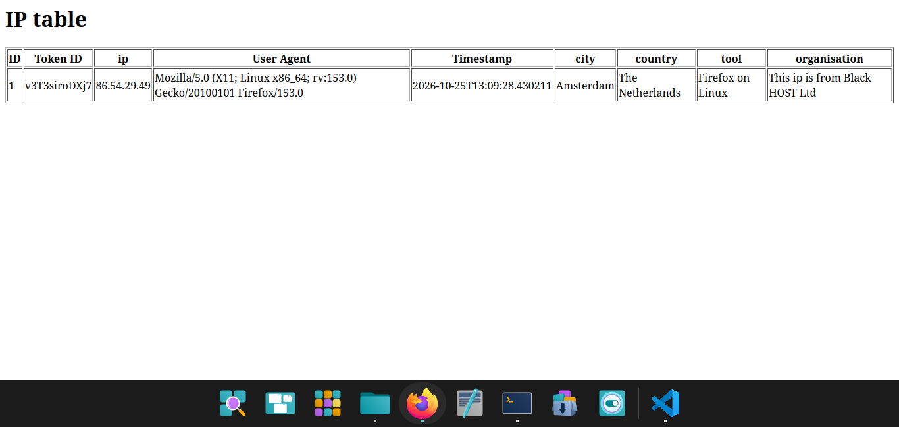

Webhook-Factory

A Python-based honeytoken factory and threat intelligence dashboard.

This tool generates fake files (like .env configs or HTML login portals) embedded with unique tracking tokens. When a bot or human opens them, the files silently ping a local listener. The listener logs their IP, User-Agent, and geolocation.

It is designed to catch attackers who are already inside your network looking for credentials, without triggering false positives on legitimate users and not to make random links and be used as a ip grabber please.
Features

    Dynamic Traps: Generates .env files with fake AWS keys and HTML pages with hidden 1x1 tracking pixels. Every generated file gets a unique 12-character token.

    Local GeoIP Lookup: Uses MaxMind GeoLite2 databases instead of third-party APIs. Services like Facebook send crawlers as soon as a link is shared, and third-party lookup APIs often rate-limit them, so a local database avoids that problem

    ASN/VPN Detection: Checks the network owner of the incoming IP. If it belongs to a hosting provider or known VPN, it shows the organisation. It won't catch a sophisticated attacker using a residential proxy, but it catches the lazy ones.

    Secret Dashboard: A local web UI to view your captured targets. It's protected by a randomized URL generated on startup, so random people can't browse your threat intel.

    Persistent Token Registry: Stores active honeytoken values in `tokens.txt`, allowing the separate trap-generator scripts and FastAPI listener to share token state. Each generator updates its own token entry while preserving the other trap type's entry.

Architecture

    The Factory (make_*.py): Generates the trap files and builds the tracking URLs.

    The Token Registry (tokens.txt): Stores the active token for each trap type. The generators update the relevant entry, and the listener reads the registry to validate incoming requests.

    The Listener (server.py): A FastAPI endpoint that catches the incoming webhooks and returns a blank 1x1 PNG so the client doesn't get suspicious.

    The Enrichment (geoip.py): Takes the IP and looks it up in the local MaxMind databases to find the city, country, and ISP.

    The Database (db.py): Logs the data in SQLite.

    The Dashboard: Renders the SQLite data into a basic HTML table.

Setup

1. Install dependencies:
```bash
python -m venv .venv
source .venv/bin/activate
pip install fastapi uvicorn requests geoip2 user-agents
```
2. Get the GeoIP Databases:
You need the local MaxMind databases for location tracking to work and get which VPN or organisation is being used by the person using vpn. Run these commands in your terminal to download them directly into your data/ folder:
```bash
mkdir -p data
wget -O data/GeoLite2-City.mmdb https://raw.githubusercontent.com/P3TERX/GeoLite.mmdb/download/GeoLite2-City.mmdb
wget -O data/GeoLite2-ASN.mmdb https://raw.githubusercontent.com/P3TERX/GeoLite.mmdb/download/GeoLite2-ASN.mmdb
```
(If you are on Mac, you might need to use curl -o instead of wget).

3. Start the server:
```bash
uvicorn server:app --reload
```
Check your terminal. The server will print a Dashboard Path: /dashboardXXXXXX. Save that URL; it's the only way to access the web UI. This is done to make reaching the dashboard from unauthorised people extremely hard as the random string generating has more than 3 sextillion combinations.

4. Generate a trap:
FOR TESTING PURPOSES
Open a second terminal tab. Pass your public tunnel URL (via ngrok, VS Code Ports, etc.) as an argument. Make sure to include /t/ at the end.
```bash
python make_html_trap.py <paste_your_url_here>
```
or you can create a secrets.env file as well for a trap so run:
```bash
python make_credential.py <paste_your_url_here>
```
This is to be used for testing purposes only, Please use this trap inside your own server so accessing the link will catch hackers not someone innocent. The public URL comes from port forwarding (VS Code) or a tunnel tool such as ngrok or Cloudflared. 
### Token Persistence

The first trap-generation run creates `tokens.txt` if it does not already exist. This file allows the trap generators and the FastAPI server to share token information even when running in separate terminal processes.

Run the generator scripts and the server from the project directory so they access the same `tokens.txt` file.

**Note:** Regenerating a trap replaces its previously registered token. Consequently, an older HTML trap or credential trap of the same type will no longer pass token validation once its token has been replaced. The other trap type's registered token remains unchanged.

5. Deploy:
Move the generated company_login.html or secrets.env file to a location inside your server where an attacker might look if they break into it. Monitor your dashboard or database to see who takes the bait.

Disclaimer and Ethical Use

This tool is designed for defensive cybersecurity, educational purposes, and authorized security testing only.

Because this tool logs incoming IP addresses, User-Agents, and geolocates requests, it operates on the exact same technical principles as an ip grabber.

By downloading or using this software, you agree to the following:

    You will only deploy these honeytokens on systems, servers, or networks that you own or have explicit, written permission to test.

    You will not use this tool to track, dox, harass, or deceive individuals without their consent.

    You will comply with all local, state, and international privacy laws regarding the collection and storage of personal data.

    I assume no liability and am not responsible for any misuse, damage, or legal consequences caused by this software. Do not cause any harm using this.

Made for educational purposes by Saksham Paudel: (https://github.com/sakshamp30-oss)